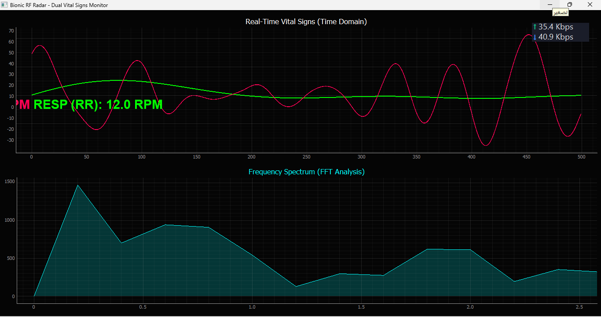
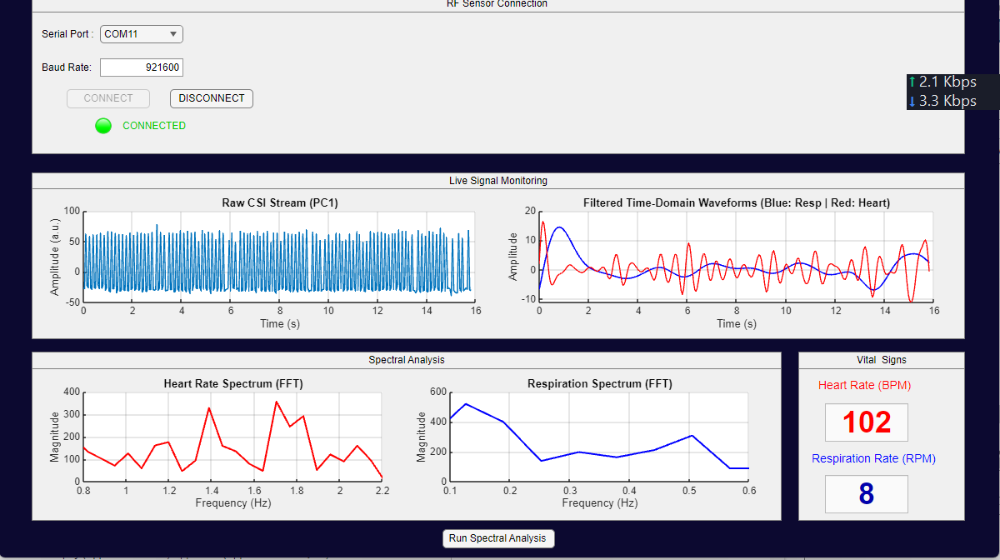
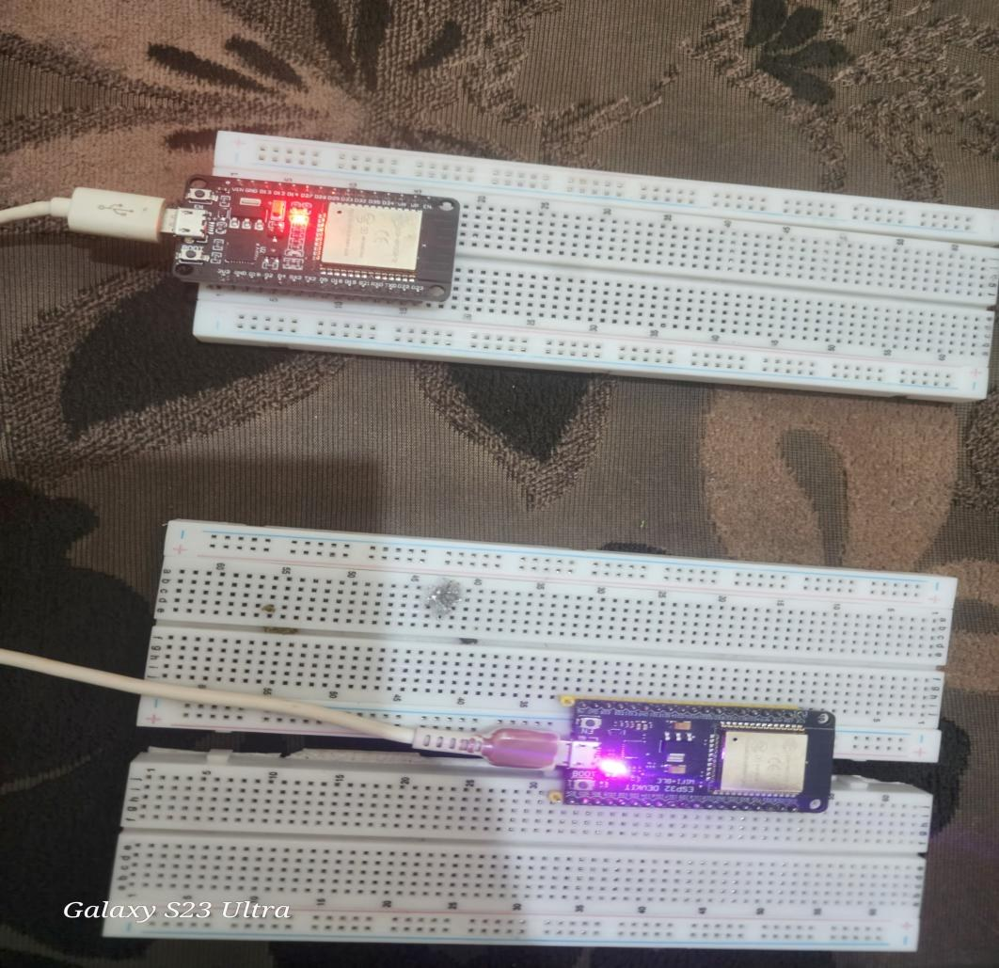
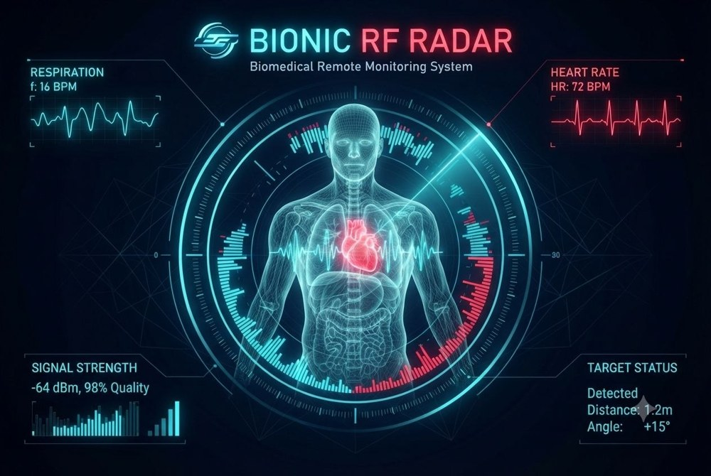

# Bionic RF Radar

<p>
  
  
  
  
</p>

**Contactless respiration and heart-rate estimation from Wi-Fi channel state information (CSI), using two ESP32 boards.**

> **Research prototype, not a medical device.** Estimates depend on room geometry, multipath, subject movement and placement.

Breathing and heartbeat move the chest by a few millimetres, which slightly changes how a Wi-Fi signal propagates through a room.
Two ESP32 boards form a dedicated sensing link: the transmitter broadcasts a steady stream of ESP-NOW packets, and the receiver extracts the CSI of every packet
(the complex channel response on each OFDM subcarrier) and streams it to a PC over serial. The PC reduces the subcarriers with PCA, separates the respiration and heartbeat bands
with band-pass filters, and estimates both rates from an FFT peak.



<p align="center">
  
  
</p>

*Top: Python live GUI. Bottom left: MATLAB App Designer interface. Bottom right: the transmitter and receiver boards.*

## System architecture

```text
ESP32 transmitter --(ESP-NOW, 100 packets/s, channel 1)--> ESP32 receiver --(CSI over serial, 921600 baud)--> PC: PCA -> band-pass -> FFT -> RR / HR
```

| Stage | Location | What it does |
|---|---|---|
| Transmitter | [`firmware/sender`](firmware/sender/sender.ino) | Disconnects from any router, locks the radio to channel 1 and broadcasts a 4-byte packet counter over ESP-NOW every 10 ms |
| Receiver | [`firmware/receiver`](firmware/receiver/receiver.ino) | Runs in promiscuous mode on channel 1; for every packet a CSI callback prints `RSSI:<dBm>,DATA:<csi bytes>` at 921600 baud |
| Live GUI | [`python`](python/radar_gui.py) | Parses the serial stream, runs the DSP pipeline and plots the signals in real time (PyQtGraph) |
| Analysis app | [`matlab`](matlab/Bionic_RF_Radar.mlapp) | Second implementation in MATLAB App Designer, with numeric read-outs and CSV export |

## Signal processing

The two implementations share the same structure but are **not identical**:

| Step | Python (`radar_gui.py`) | MATLAB (`Bionic_RF_Radar.mlapp`) |
|---|---|---|
| Feature used | CSI **phase** per subcarrier, unwrapped, linear trend across subcarriers removed | CSI **amplitude** per subcarrier |
| Sampling rate assumed | 100 Hz | 20 Hz |
| Analysis window | 500 packets (5 s) | 400 samples (20 s at 20 Hz) |
| Dimensionality reduction | PCA, first component (scikit-learn) | PCA, first component (`pca`) |
| Static-clutter removal | none | 2 s moving mean subtracted |
| Respiration band | 0.15-0.50 Hz, Butterworth (order 2), zero-phase `filtfilt` | same |
| Heartbeat band | 0.80-2.00 Hz, Butterworth (order 2), zero-phase `filtfilt` | same |
| Rate estimate | FFT peak; RR shown if 8-30 RPM, HR if 50-120 BPM | FFT peak, rounded to whole RPM / BPM |
| Output | Live plots at 20 frames per second | Plots, numeric read-outs, CSV export |

## Getting started

**Hardware:** two ESP32 boards and two USB cables.

1. **Flash the firmware** with the Arduino IDE and the ESP32 board package. Upload [`sender.ino`](firmware/sender/sender.ino) to the first board and
   [`receiver.ino`](firmware/receiver/receiver.ino) to the second. Both sketches use channel 1.
2. **Python live GUI**
   ```bash
   cd python
   pip install -r requirements.txt
   # set PORT in radar_gui.py to the receiver's serial port (default: COM11)
   python radar_gui.py
   ```
   The first estimate appears after the 5 s buffer fills.
3. **MATLAB app** (built with R2024a): open [`Bionic_RF_Radar.mlapp`](matlab/Bionic_RF_Radar.mlapp), press **Run**, choose the serial port, set the baud rate to 921600
   and press **CONNECT**. **Run Spectral Analysis** refreshes the spectra and **Export Data (CSV)** saves the buffer.

A standalone Windows executable can be produced from the app with MATLAB Compiler; build output is not stored in this repository.

## Validation status and known limitations

- **No reference measurements are included.** There is no dataset comparing the estimates with a reference (manual breath counting, pulse oximeter), so accuracy is not quantified here.
- **Python resolution.** A 5 s window gives 0.2 Hz FFT bins. Tested with synthetic signals, the respiration read-out can only show 12 or 24 RPM
  and the heart-rate read-out only multiples of 12 BPM (48 to 120).
- **Sampling-rate mismatch.** Python assumes 100 Hz (the transmitter's rate) and MATLAB assumes 20 Hz. Both cannot be right for the same stream.
  Measure the real packet rate and set `FS` (Python) and `Fs` (MATLAB) accordingly.
- **MATLAB moving-mean step** attenuates slow breathing: its gain is 0.14 at 0.15 Hz and 0.36 at 0.25 Hz.
- **No outlier rejection:** a median filter is not implemented in either version.
- **Hard-coded settings:** `PORT = 'COM11'` in the Python script (Windows-style port name).
- **Single subject and fixed geometry:** estimates are sensitive to multipath, subject motion and interference.

## Roadmap

- [ ] Collect a reference dataset (pulse oximeter or chest strap plus manual breath count) and report the mean absolute error.
- [ ] Improve the Python resolution: longer window (20-30 s), zero-padding and parabolic peak interpolation.
- [ ] Measure the true packet rate from timestamps and use one sampling rate in both implementations.
- [ ] Add outlier rejection (median filter) for sudden movements.
- [ ] Select the serial port automatically or from the command line.
- [ ] Confidence scoring, motion-artifact rejection and multi-subcarrier fusion.

## Repository structure

```text
Bionic-RF-Radar/
├── README.md
├── firmware/
│   ├── sender/sender.ino          # ESP-NOW transmitter
│   └── receiver/receiver.ino      # CSI receiver
├── python/
│   ├── radar_gui.py               # live GUI and DSP
│   └── requirements.txt
├── matlab/
│   └── Bionic_RF_Radar.mlapp      # App Designer application
└── docs/images/
```

## Project identity

<p align="center">
  
</p>

*Concept illustration used as the splash screen of the MATLAB app. The distance, angle and signal-quality read-outs shown here are illustrative; they are not implemented.*

## About

Individual project for the course *Analog & Digital Signals*, Department of Mechatronics Engineering, Faculty of Engineering, University of Sana'a.

**Author:** Abdulmlek Al-Sharee &mdash; [@abdulmlekalsharee-create](https://github.com/abdulmlekalsharee-create)
